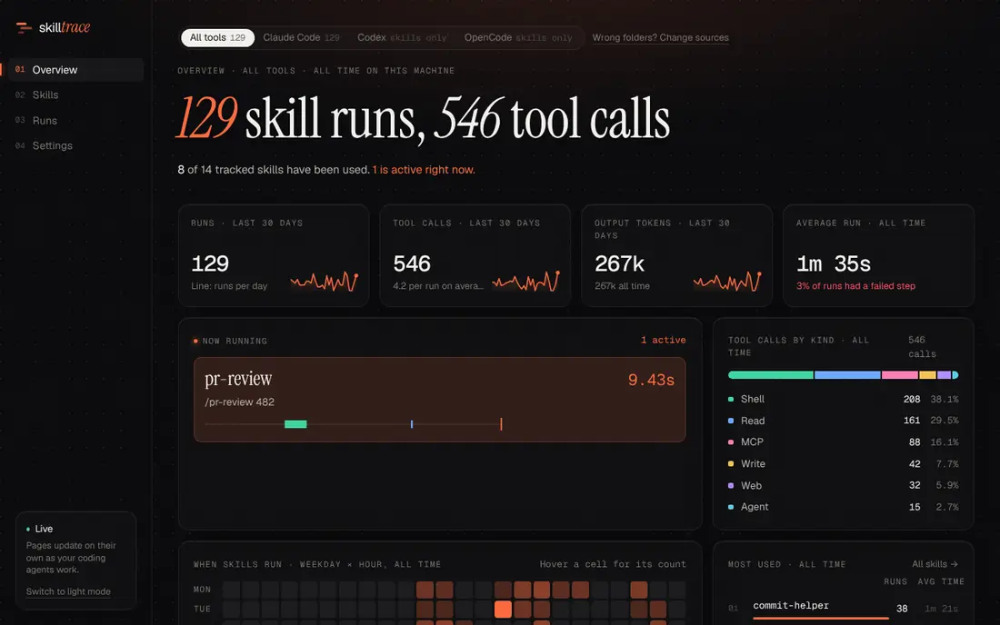
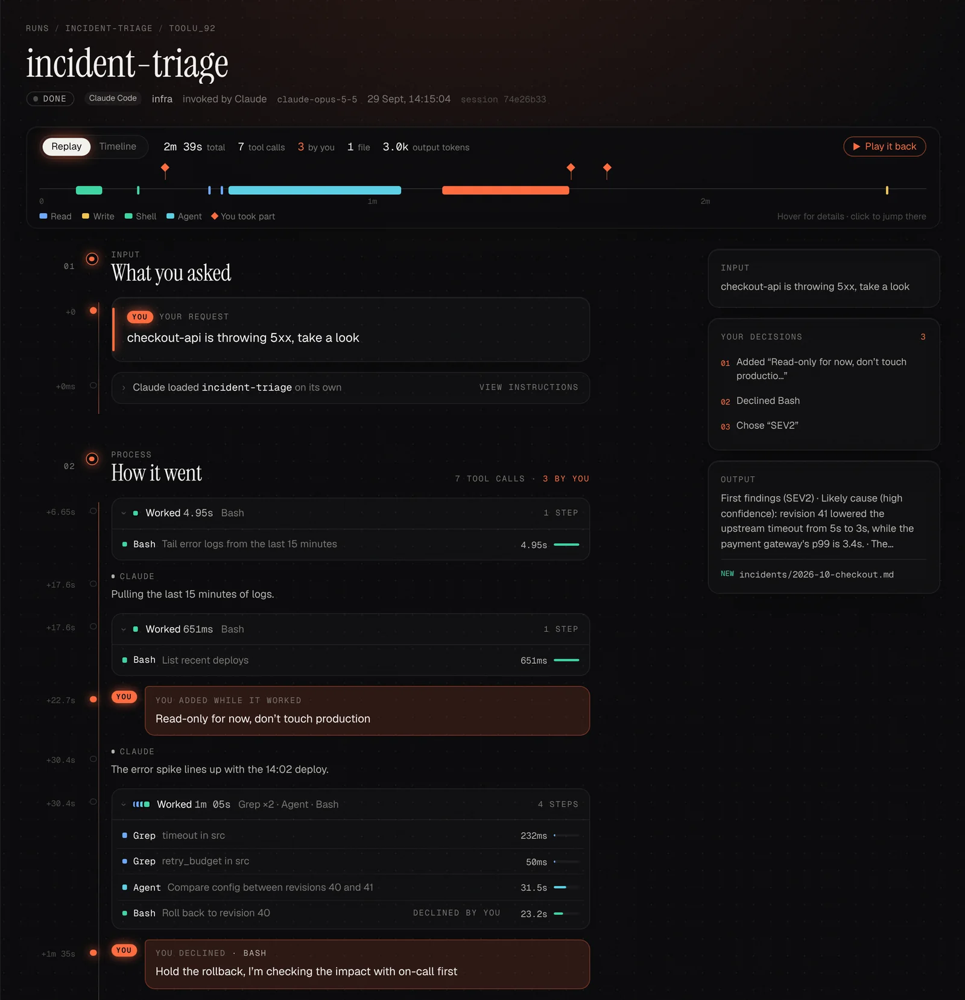
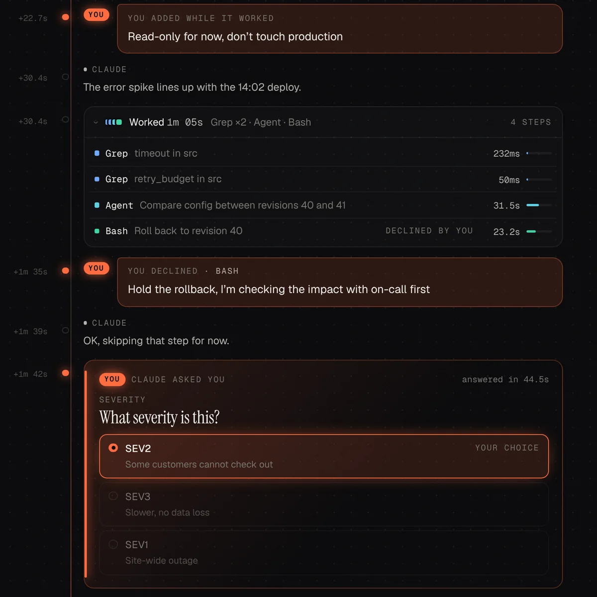
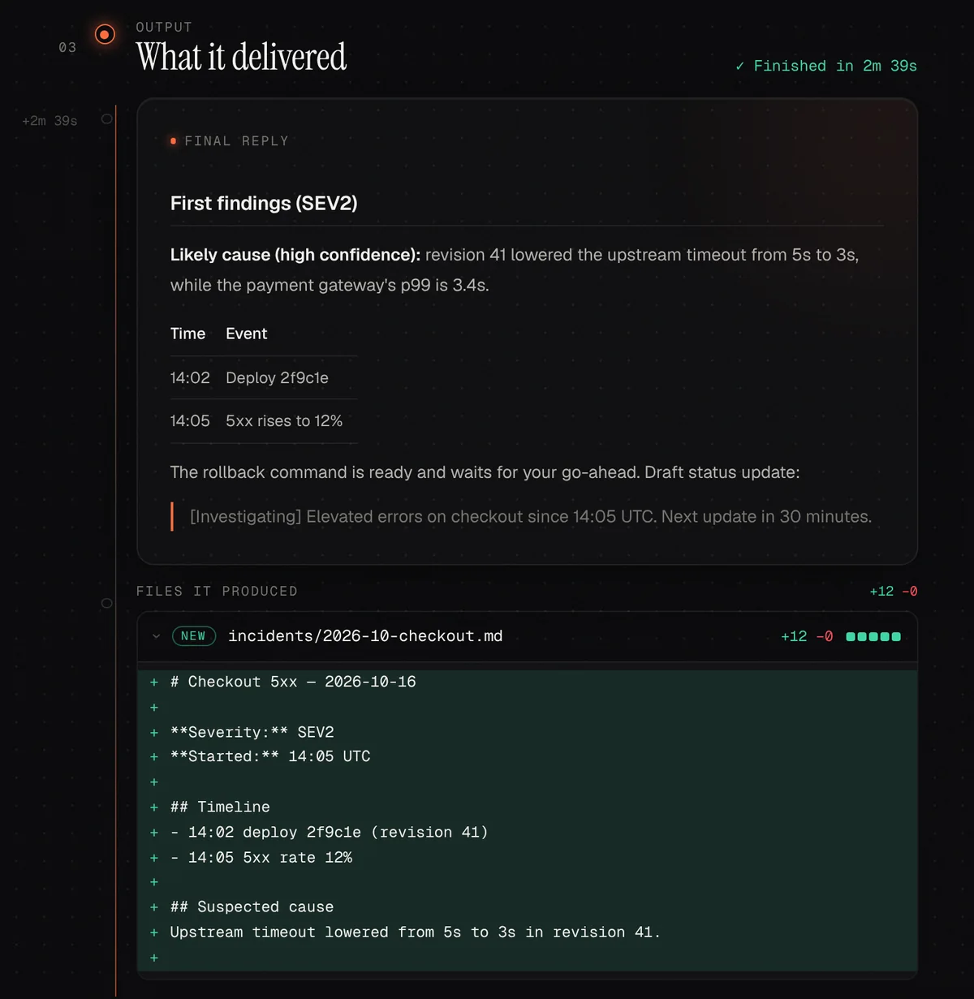
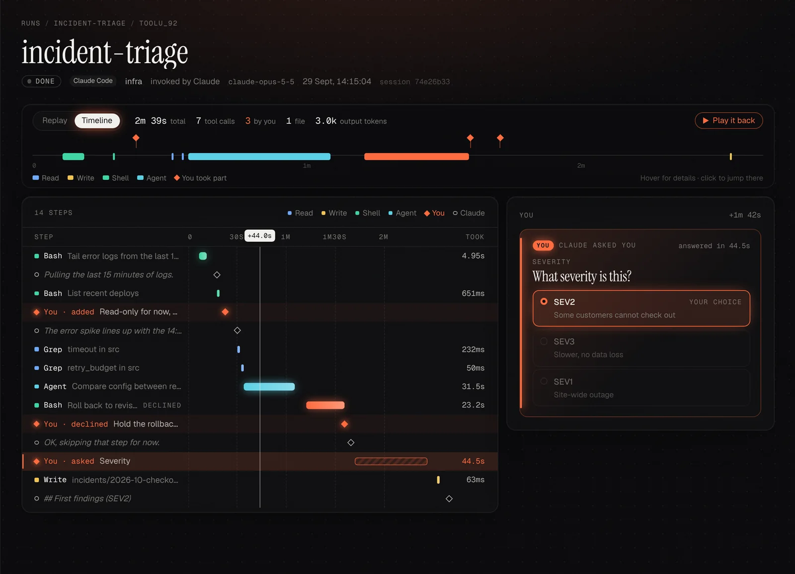
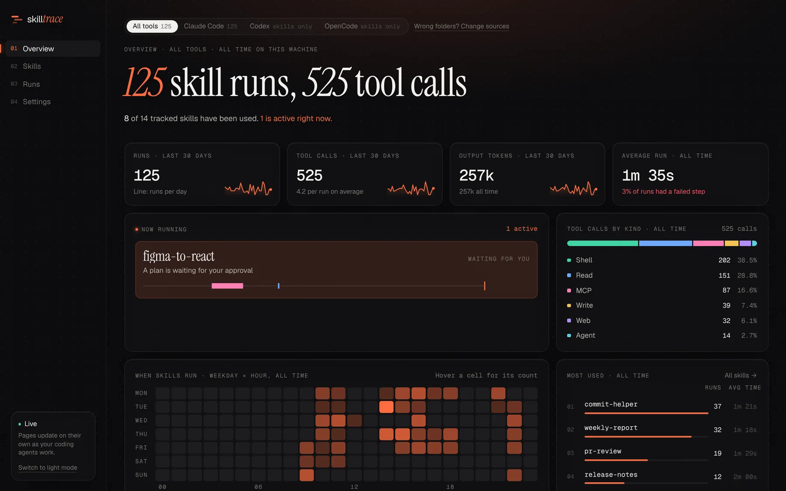
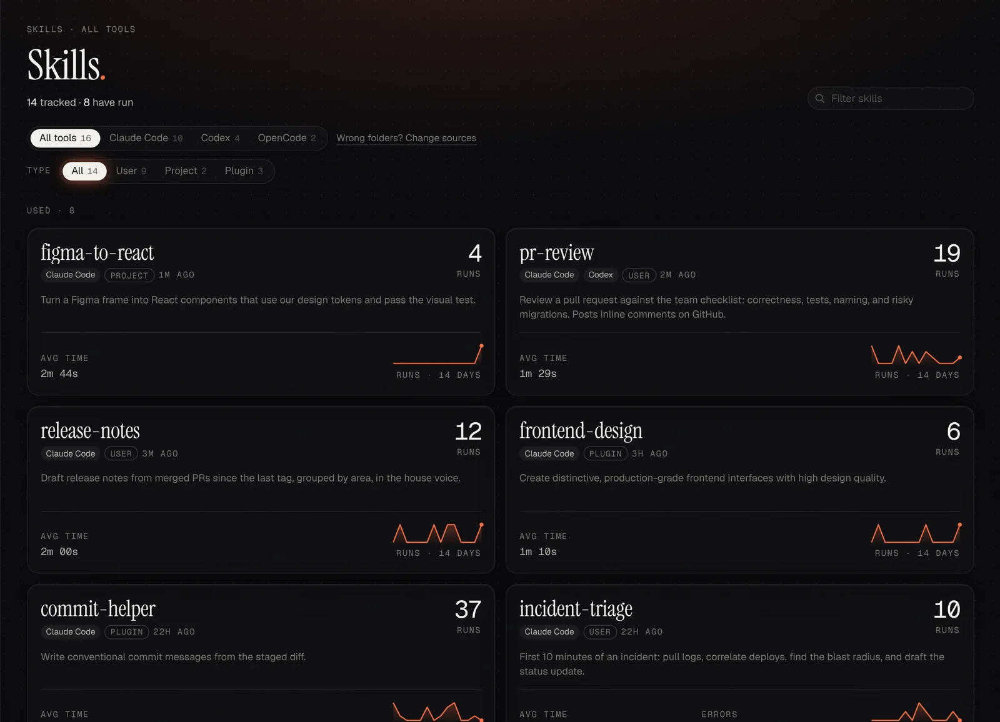
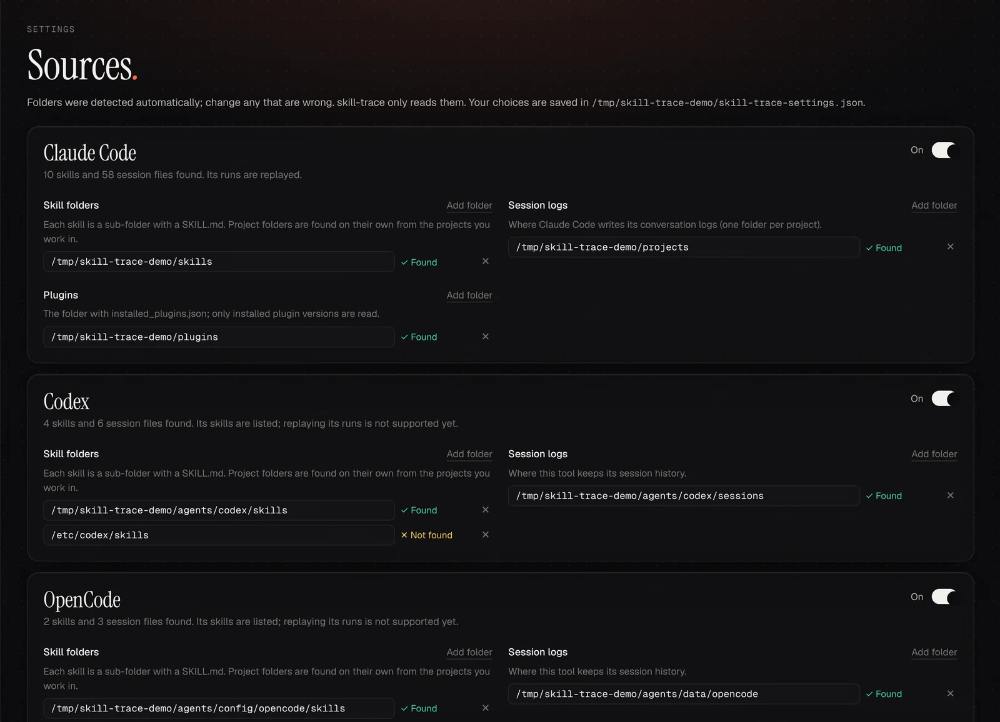
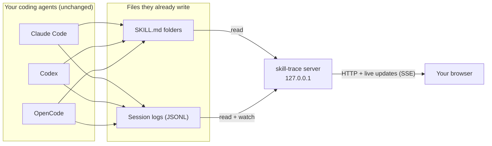

<div align="center">


# skill-trace

**Replay every skill your coding agent runs: what you asked, what you decided, and what it delivered.**

A local, read-only dashboard for **Claude Code** skills, which also lists **Codex** and **OpenCode** skills.

[](LICENSE)


**English** · [简体中文](README.zh-CN.md)


<sub>Open a run, play it back, inspect the timeline, choose which skills to track.</sub>

</div>

## Why

Skills do their work inside long agent conversations. Afterwards it is hard to answer simple questions: *Did the skill finish? What did it actually do? Where did I have to step in? What did it produce?*

skill-trace answers them from the session logs your agent already writes. Each skill run becomes a replay you can read top to bottom, with the moments you took part in highlighted. Nothing is installed into your agent and nothing leaves your machine.

## Features

### Replay a run from input to outcome

Every run reads as three chapters: **what you asked**, **how it went**, and **what it delivered**. Tool calls fold into groups you can open to see each step's full input and output. **Play it back** replays the run step by step.



### See where you stepped in

The moments that need a person are what make a skill run go right or wrong, so they are never buried:

- **Questions** Claude asked, with every option it offered and the one you picked (or the answer you typed yourself)
- **Plans** you approved or sent back, with your feedback
- **Actions you declined** at the permission prompt, and why
- **Messages you added** while it worked, replies to its questions, and interruptions

<table>
  <tr>
    <td width="50%"></td>
    <td width="50%"></td>
  </tr>
  <tr>
    <td align="center"><sub>Your part: steering, declining, choosing</sub></td>
    <td align="center"><sub>The outcome: final reply and the files it wrote</sub></td>
  </tr>
</table>

### Know where the time went

The **Timeline** view lays every step on a time axis, colored by tool kind, including how long Claude waited for you. Hover any bar to see what it was; click to inspect it.



### Every skill on your machine, and how it is used

The **Skills** view lists your own, project, plugin and built-in skills with run counts, average duration and a 14-day trend. Open one to read its rendered `SKILL.md`, browse its files and see its run history. **Overview** sums it up: what is running now, when skills run, which are used most.

<table>
  <tr>
    <td width="50%">
      <picture>
        <source media="(prefers-color-scheme: light)" srcset="docs/assets/overview-light.webp" />
        
      </picture>
    </td>
    <td width="50%"></td>
  </tr>
  <tr>
    <td align="center"><sub>Overview</sub></td>
    <td align="center"><sub>Skills</sub></td>
  </tr>
</table>

### One dashboard for several agents

skill-trace detects the folders of **Claude Code**, **Codex** and **OpenCode**. One switch at the top of Overview, Skills and Runs scopes every page to a single tool, and every skill and run carries a tag saying where it came from. In **Settings**, change any folder that was detected wrong and choose exactly which skills to track, for example only the ones you wrote yourself.



### Live

Pages update while the agent works. A running skill shows up on Overview the moment it starts, and a skill that stopped to ask you something is marked **Waiting for you**.

## Quick start

Requires **Node.js 20.19 or newer**.

```bash
git clone https://github.com/Gamehu/skill-trace.git
cd skill-trace
npm install
npm run build
npm start          # http://localhost:4317
```

Then use a skill in Claude Code. The run appears while it happens.

No skill runs yet? Look around with generated data first. It lives in a temporary folder, and one session keeps running live:

```bash
npm run build && npm run demo
```

## How it works



1. **Find skills.** Every enabled tool's skill folders are scanned for `SKILL.md`, along with project-level folders (`.claude/skills`, `.codex/skills`, `.opencode/skills`, `.agents/skills`) of the projects you work in. A skill reachable through several paths, for example a symlink shared between tools, is listed once with every tag.
2. **Find runs.** A run starts when the agent loads a skill (or you type `/skill-name`) and ends at the next skill or at a request unrelated to it. Replies that answer the skill stay in the run: after Claude asks a question, or when the reply is a short answer such as "yes" or "2". So do messages typed while it works and instructions after an interruption.
3. **Read the outcome.** The final reply is what Claude wrote after its last action. Files come from its `Write` and `Edit` calls.
4. **Stay live.** Folders are watched with native recursive file watching, and changes reach open pages over Server-Sent Events.

## Supported tools

| Tool | Skills | Run replay | Default folders |
|---|:---:|:---:|---|
| Claude Code | ✅ | ✅ | `~/.claude/skills`, `~/.claude/plugins`, sessions in `~/.claude/projects` |
| Codex | ✅ | Planned | `~/.codex/skills`, `/etc/codex/skills`, sessions in `~/.codex/sessions` |
| OpenCode | ✅ | Planned | `~/.config/opencode/skills`, data in `~/.local/share/opencode` |

Each tool's own environment variables are honored (`CLAUDE_CONFIG_DIR`, `CODEX_HOME`, `XDG_CONFIG_HOME`, `XDG_DATA_HOME`), and every folder can be changed in **Settings**.

## Privacy and safety

- **Read-only toward your tools.** It never modifies skills, agent settings or hooks, and adds nothing to the agent's context, so the model's input and output are exactly what they would be without it.
- **One file written:** its own settings, `~/.config/skill-trace/config.json`, holding only what you changed.
- **Local only.** The server listens on `127.0.0.1`. It makes no network requests, collects no telemetry and bundles its fonts. Settings can only be saved by the page itself (same-origin JSON requests to localhost).
- **Your transcripts stay yours.** Pages show full requests and tool output, which can include secrets that appeared in your sessions. Keep the port private.

## Configuration

Most people never need this; **Settings** covers folders and which skills to track.

| Variable | Default | Purpose |
|---|---|---|
| `PORT` | `4317` | Server port (also `npm start -- --port 5000`) |
| `SKILL_TRACE_CONFIG` | `~/.config/skill-trace/config.json` | Settings file |
| `CLAUDE_CONFIG_DIR`, `CODEX_HOME`, `XDG_CONFIG_HOME`, `XDG_DATA_HOME` | each tool's default | Where folders are detected |

## FAQ

<details>
<summary><b>Does it slow down or change my agent?</b></summary>

No. It only reads files the agent has already written, in its own process. The agent does not know it exists.
</details>

<details>
<summary><b>A skill of mine is missing.</b></summary>

Open **Settings** and check that its folder is listed and marked *Found*, and that the skill is checked under *Skills to track*. The skill needs a `SKILL.md`; frontmatter that strict YAML rejects (such as a description containing `: `) is still read.
</details>

<details>
<summary><b>Why are there no runs from Codex or OpenCode?</b></summary>

Their skills are listed today. Replaying their sessions needs support for their log formats, which is on the roadmap.
</details>

<details>
<summary><b>I updated the code but the page looks the same.</b></summary>

`npm start` serves the built page in `dist/`. Run `npm run build`, restart the server, then reload the browser.
</details>

## Development

```bash
npm run dev        # UI with hot reload on :5173, API restarting on change
npm run demo       # seeded demo data with one live session
npm test           # parser, run boundaries, settings
npm run typecheck
```

```
server/            API, skill scanning, transcript parsing, settings, file watching
web/src/           UI (React, Tailwind CSS); views/ holds one file per page
scripts/demo.ts    demo data generator
bin/               CLI entry
```

Built with TypeScript, [Hono](https://hono.dev), [Vite](https://vite.dev), [React](https://react.dev), [Tailwind CSS](https://tailwindcss.com) and [Shiki](https://shiki.style).

## Roadmap

- [ ] Run replay for Codex and OpenCode
- [ ] Steps inside subagents
- [ ] `npx skill-trace` without cloning

## Contributing

Issues and pull requests are welcome. Before opening a pull request, run:

```bash
npm run typecheck && npm test && npm run build
```

## License

[MIT](LICENSE) © Gamehu
