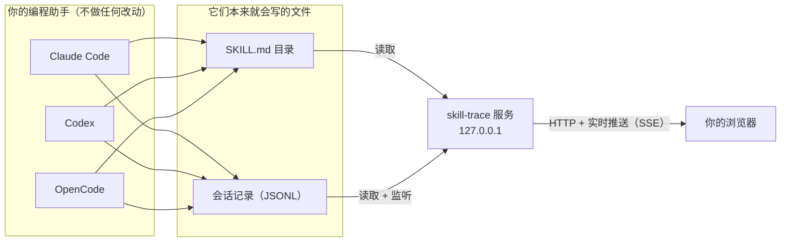

<div align="center">


# skill-trace

**把编程助手跑过的每一次 Skill 完整回放出来：你提了什么、中途做了哪些决定、最后交付了什么。**

一个本地运行、只读的看板，支持 **Claude Code** 的 Skill，同时能列出 **Codex** 和 **OpenCode** 的 Skill。

[](LICENSE)


[English](README.md) · **简体中文**


<sub>打开一次运行 → 逐步回放 → 查看时间轴 → 选择要跟踪的 Skill</sub>

</div>

## 为什么需要它

Skill 是在很长的对话里干活的。跑完之后，一些简单的问题反而很难回答：*它跑完了吗？中间到底做了什么？哪里需要我插手？最后产出了什么？*

skill-trace 直接读取编程助手本来就会写下的会话记录，把每一次 Skill 运行整理成一段可以从头读到尾的回放，并把你参与的环节高亮出来。不用往助手里装任何东西，数据也不会离开你的电脑。

## 功能

### 从输入到结果，完整回放一次运行

每次运行分成三段来读：**你提了什么**、**过程怎样**、**交付了什么**。工具调用按段折叠，展开能看到每一步完整的输入和输出。点 **Play it back** 可以逐步重放整个过程。


### 你参与的每个环节，一眼看到

一次 Skill 跑得好不好，往往取决于需要人拍板的那几下，所以这些环节不会被淹没在过程里：

- **Claude 的提问**：列出它给的全部选项，标出你选了哪个；你自己输入的答案也会单独显示
- **计划审批**：你批准了还是打回了，以及你的意见
- **被你拒绝的操作**：在权限确认时拒绝的命令，以及你给的理由
- **你的插话**：运行中追加的消息、对提问的回复、按 Esc 打断

<table>
  <tr>
    <td width="50%"></td>
    <td width="50%"></td>
  </tr>
  <tr>
    <td align="center"><sub>你的参与：插话、拒绝、做选择</sub></td>
    <td align="center"><sub>最终结果：结论和产出的文件</sub></td>
  </tr>
</table>

### 时间花在哪里

**时间轴**视图把每一步按时间排开，按工具类型着色，等你回复的时长也画在上面。鼠标悬停看是什么，点击查看详情。


### 本机所有 Skill 及其使用情况

**Skills** 页列出你自己的、项目里的、插件和内置的 Skill，带调用次数、平均耗时和近 14 天走势。点进去可以看到渲染后的 `SKILL.md`、附带文件和历史运行。**Overview** 是总览：正在运行什么、通常什么时候用、哪些用得最多。

<table>
  <tr>
    <td width="50%">
      <picture>
        <source media="(prefers-color-scheme: light)" srcset="docs/assets/overview-light.webp" />
        
      </picture>
    </td>
    <td width="50%"></td>
  </tr>
  <tr>
    <td align="center"><sub>Overview 总览</sub></td>
    <td align="center"><sub>Skills 列表</sub></td>
  </tr>
</table>

### 一个看板，多个编程工具

skill-trace 会自动识别 **Claude Code**、**Codex**、**OpenCode** 的目录。Overview、Skills、Runs 顶部有同一个切换，可以只看某一个工具；每个 Skill 和每次运行都带来源标签。在 **Settings** 里可以修改识别错的目录，也可以精确选择跟踪哪些 Skill，比如只看你自己写的。


### 实时更新

助手工作时页面会跟着更新。Skill 一开始运行就会出现在 Overview 上；停下来等你确认的会标成 **Waiting for you**。

## 快速开始

需要 **Node.js 20.19 及以上**。

```bash
git clone https://github.com/Gamehu/skill-trace.git
cd skill-trace
npm install
npm run build
npm start          # http://localhost:4317
```

然后在 Claude Code 里正常使用 Skill，运行过程会实时出现在页面上。

还没有 Skill 运行记录？可以先用生成的演示数据看看效果。数据放在临时目录里，其中一个会话会持续实时运行：

```bash
npm run build && npm run demo
```

## 工作原理



1. **找到 Skill**：扫描每个已启用工具的 Skill 目录里的 `SKILL.md`，以及你工作过的项目里的项目级目录（`.claude/skills`、`.codex/skills`、`.opencode/skills`、`.agents/skills`）。同一个 Skill 能从几条路径找到时（比如用软链接给几个工具共用），只列一次，并带上所有来源标签。
2. **划分运行**：助手加载一个 Skill（或你输入 `/skill-name`）时开始，到下一个 Skill、或一条与它无关的新请求时结束。回答这个 Skill 的回复仍算在这次运行里：Claude 刚提了问题，或你的回复是"确认 / 好 / 2"这类短答复。运行中追加的消息、打断后给的新指示也一样。
3. **提取结果**：最终回复是 Claude 最后一次操作之后写的话；产出文件来自它的 `Write`、`Edit` 调用。
4. **保持实时**：用系统原生的递归文件监听盯着这些目录，变化通过 Server-Sent Events 推送到打开的页面。

## 支持的工具

| 工具 | Skill 列表 | 运行回放 | 默认目录 |
|---|:---:|:---:|---|
| Claude Code | ✅ | ✅ | `~/.claude/skills`、`~/.claude/plugins`，会话在 `~/.claude/projects` |
| Codex | ✅ | 计划中 | `~/.codex/skills`、`/etc/codex/skills`，会话在 `~/.codex/sessions` |
| OpenCode | ✅ | 计划中 | `~/.config/opencode/skills`，数据在 `~/.local/share/opencode` |

会遵循各工具自己的环境变量（`CLAUDE_CONFIG_DIR`、`CODEX_HOME`、`XDG_CONFIG_HOME`、`XDG_DATA_HOME`），所有目录都能在 **Settings** 里修改。

## 隐私与安全

- **对你的工具只读**：不修改 Skill、助手配置或 hook，也不往对话里注入任何内容，模型的输入输出和不装它时完全一样。
- **只写一个文件**：它自己的设置 `~/.config/skill-trace/config.json`，只记录你改过的部分。
- **只在本机运行**：服务只监听 `127.0.0.1`，不发任何网络请求，没有遥测，字体也是本地打包的。设置只能由页面本身保存（发往 localhost 的同源 JSON 请求）。
- **会话内容只属于你**：页面会完整展示请求和工具输出，其中可能包含会话里出现过的密钥。请不要把端口暴露出去。

## 配置

大多数情况下用不到，目录和跟踪哪些 Skill 都可以在 **Settings** 里设置。

| 变量 | 默认值 | 作用 |
|---|---|---|
| `PORT` | `4317` | 服务端口（也可以 `npm start -- --port 5000`） |
| `SKILL_TRACE_CONFIG` | `~/.config/skill-trace/config.json` | 设置文件位置 |
| `CLAUDE_CONFIG_DIR`、`CODEX_HOME`、`XDG_CONFIG_HOME`、`XDG_DATA_HOME` | 各工具默认 | 影响自动识别的目录 |

## 常见问题

<details>
<summary><b>会拖慢或改变我的编程助手吗？</b></summary>

不会。它在自己的进程里读取助手已经写好的文件，助手并不知道它的存在。
</details>

<details>
<summary><b>我的某个 Skill 没显示出来。</b></summary>

打开 **Settings**，确认它所在的目录在列表里且标为 *Found*，并且在 *Skills to track* 里勾选了它。Skill 目录里需要有 `SKILL.md`；严格 YAML 解析不了的 frontmatter（比如描述里带 `: `）也能正常读取。
</details>

<details>
<summary><b>为什么看不到 Codex 或 OpenCode 的运行记录？</b></summary>

目前能列出它们的 Skill。回放它们的会话需要适配各自的记录格式，已在计划中。
</details>

<details>
<summary><b>更新了代码，页面却没变化。</b></summary>

`npm start` 提供的是 `dist/` 里已经构建好的页面。执行 `npm run build`，重启服务，再刷新浏览器。
</details>

## 开发

```bash
npm run dev        # 前端热更新（:5173），API 改动自动重启
npm run demo       # 带一个实时会话的演示数据
npm test           # 会话解析、运行边界、设置
npm run typecheck
```

```
server/            API、Skill 扫描、会话记录解析、设置、文件监听
web/src/           前端（React、Tailwind CSS），views/ 下每个页面一个文件
scripts/demo.ts    演示数据生成
bin/               命令行入口
```

使用 TypeScript、[Hono](https://hono.dev)、[Vite](https://vite.dev)、[React](https://react.dev)、[Tailwind CSS](https://tailwindcss.com) 和 [Shiki](https://shiki.style) 构建。

## 路线图

- [ ] Codex 和 OpenCode 的运行回放
- [ ] 展开子代理内部的步骤
- [ ] 无需克隆，直接 `npx skill-trace`

## 参与贡献

欢迎提 Issue 和 Pull Request。提交 PR 前请先运行：

```bash
npm run typecheck && npm test && npm run build
```

## 许可证

[MIT](LICENSE) © Gamehu
